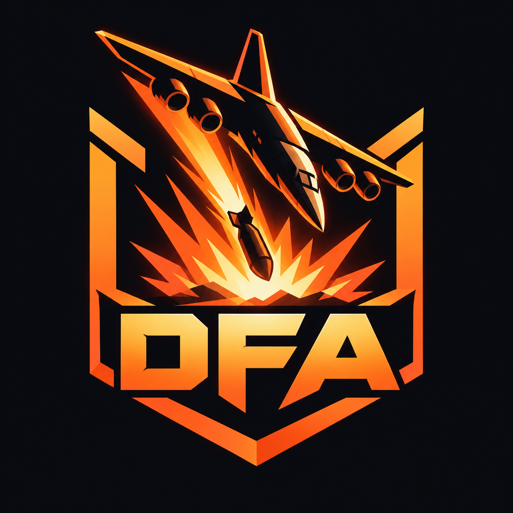

<p align="center"></p>

# Death From Above

A side-view 3D bomber. You fly a strike aircraft over a living battlefield, break enemy columns
before they reach your airfield, and dodge flak, tracers and SAMs while you do it.

Everything you see is rendered by a custom WebGL2 engine written for this project — no three.js,
no textures or audio files. Models are generated from code, sounds are synthesised in WebAudio.

## Run it

```bash
pnpm install
pnpm dev
```

Open the printed URL in a recent Chrome, Edge, Firefox or Safari (WebGL 2 required). A GPU is
strongly recommended; quality presets (LOW / MEDIUM / HIGH) are on the title screen.

## Controls

| Action                            | Keyboard / mouse                        | Gamepad     |
| --------------------------------- | --------------------------------------- | ----------- |
| Steer toward a direction          | `W A S D` or arrow keys                 | Left stick  |
| Machine guns                      | `J`, `Z` or left mouse                  | RT          |
| Drop bomb (hold to keep dropping) | `Space`, `K`, `X` or right mouse        | A           |
| Guided missiles                   | `E`, `U` or middle mouse                | Y           |
| Aim missiles and guided bombs     | Mouse reticle                           | Right stick |
| Focus (slow motion)               | `R` or `I`                              | LT          |
| Select ordnance (your rack)       | `1`–`9`, cycle with `Q` / `Tab` / wheel | LB / RB     |
| Flares                            | `F`, `L` or `C`                         | B           |
| Afterburner                       | `Shift`                                 | X           |
| Airbrake                          | `V`                                     | View        |
| Wingman: attack my target         | `T`                                     | D-pad right |
| Wingman: cover me                 | `G`                                     | D-pad up    |
| Wingman: hit the SAMs             | `H`                                     | D-pad down  |
| Pause                             | `Esc` or `P`                            | Start       |

Steering is directional: press the way you want to fly. Asking for the opposite heading loops you
over the top. Fly low and slow over your runway to rearm specials, missiles and repair; touch down
level to land. The dotted arc is your bomb sight, and the camera widens to keep its landing point in
view.

**Focus** slows the world to a quarter speed while a meter drains (kills made outside focus
refill it). Sweep the
reticle across enemies to paint up to six locks, then fire missiles — one per target. Outside focus,
missiles and guided bombs go to whatever is under the reticle; a guided bomb released onto empty
ground follows the reticle as you move it. Without a mouse, targets are picked for you.

**Flares take timing.** A missile's seeker locks the brightest heat source in its narrow view, and
can only tell a flare from your aircraft once it is within about 450 m. A flare decoys it only if it
sits between the missile and you, so drop them as the missile closes from behind. Flares fired too
early burn out, and the seeker picks you up again. Head-on shots and radar-guided SAMs are much
harder to fool, and your afterburner makes you a brighter target.

**Your wingman** (callsign Two) flies an F-16 on your wing in campaign and endless sorties. Press
`T` to send it after your target (your first lock, whatever is under the reticle, or the best target
ahead), `H` to have it hunt the air defences (SAM sites and radars first, then AA guns), and `G` to
call it back. While covering it chases interceptors that come after you. Enemies shoot at whichever
of you is closer, its kills count toward your score, and if it is shot down a replacement takes off
from the airfield 25 seconds later.

**The tactical nuke** comes back once per wave. The airfield and supply pickups never restock it,
and losing your aircraft doesn't hand you a fresh one.

## What's in it

- **Hangar** — nine aircraft: Kestrel, Wraith, Grizzly and Albatross, plus the A-10C Warthog, F-16C
  Viper, Su-25 Frogfoot, F-4E Phantom II and B-1B Lancer. Each has its own handling, boost effect
  (afterburner, rocket bottles, stealth plasma or water-injection smoke) and weapons it can mount;
  trade payload points between them in the loadout editor. Choices are saved per aircraft.
- **Credits and upgrades** — campaign missions (more for later missions and for stars you haven't
  earned before) and endless runs (score and waves held) pay credits. Spend them in the hangar to
  buy aircraft (the Kestrel and Grizzly are free) and to upgrade each airframe's armour, engine,
  payload racks, flares, guns and missile rails, three levels each.
- **Ordnance** — GP bombs that regenerate, cluster bombs, napalm, a bunker buster, a laser-guided
  bomb, chemical canisters (drifting gas that kills infantry), an EMP airburst (stalls vehicles,
  drops helicopters, blinds missiles), terrain-hugging cruise missiles, a ballistic missile that
  climbs out of sight and comes down at Mach 6, paratroopers who land and fight, the Thunderclap,
  the tactical nuke, and guided air-to-ground missiles fired in salvos.
- **Friendly column** — your own tanks, APCs, trucks and jeeps push up the road toward the far bank.
  They halt to trade fire with whatever blocks the way, wait at a dropped span, and take damage from
  your bombs like anything else. Clear their path from the air.
- **The river** — the road crosses a river on a steel truss bridge. Drop a span and its traffic goes
  into the water while the rest of the convoy is stranded; engineers rebuild it each wave.
- **No-fire zones** — a field hospital and a village sit on the road between the airfield and the
  front, marked by red boards at each edge. Their people stroll between the houses and run indoors
  when bombs fall nearby. Killing a civilian costs 150 points, knocking down a home there costs 100,
  and flattening the hospital costs 600; each also breaks your kill chain. Napalm and gas don't care
  who is standing in them, and a house that comes down takes its sheltering family with it. The bomb
  sight warns you when it is over a no-fire zone, and enemy emplacements never dig in there.
- **Enemies** — riflemen and missile troopers (ragdolls), gun jeeps, supply trucks (drop extra
  ordnance), tanks (turrets pop off), troop carriers (unload infantry), AA gun carriers, SAM
  launchers with radar lock, howitzers, flak batteries, pillboxes, radar stations, fuel depots
  (chain reactions), searchlights at night, interceptors that dogfight you and gunships that rocket
  the airfield.
- **Bosses** — each campaign act ends with one, and endless mode sends one every fifth wave, with
  its own health bar:
  - **Behemoth**: a super-heavy tank twice a battle tank's length, with a long main gun and a rear
    AA turret that tracks aircraft. It takes a stack of bombs or a few bunker busters.
  - **River cruiser**: steams up the river and anchors across it just below the bridge, then fills
    the sky with twin flak mounts, a close-in gun and radar SAM pairs. It can't be hit until it
    drops anchor, and sinks onto the river bed when it dies.
- **Three ways to play** — pick one from the Sortie menu:
  - **Training**: twelve guided lessons, each with its own practice targets, covering steering,
    guns, bombs, ordnance selection, guided missiles, focus, flares, afterburner and airbrake, and
    rearming. You can't be shot down for good, and Enter skips a lesson.
  - **Campaign**: nine missions that get harder as you go, each with its own objectives (drop the
    bridge, kill the tanks, escort your own armour across the river, silence the flak, hunt the SAM sites, clear the sky, hold until dawn).
    Iron Column ends with the Behemoth and Wild Weasel with the river cruiser.
    Winning one unlocks the next and earns up to three stars (win, airfield above 70%, no aircraft
    lost). Progress and best scores are saved in the browser.
  - **Endless**: waves until you fall, with a budget that grows each wave and more aircraft joining
    past wave eleven. Every third wave a friendly column rolls out from the airfield; each vehicle you
    get to the far bank pays a bonus, as does clearing a wave; your five best runs are kept on a local
    leaderboard. The sky moves from golden hour through sunset, dusk and night to dawn.
- **Physics** — lift/drag/stall flight model, ballistic and guided ordnance, a rigid-body solver for
  wreckage tumbling across deformable terrain, craters and scorch marks that cool from glowing
  embers to charcoal.

## Rendering pipeline

`src/lib/engine/renderer.ts` drives every frame:

1. Shadow map (2048², texel-snapped orthographic sun frustum, 3×3 hardware PCF).
2. HDR scene pass (RGBA16F): instanced PBR-style meshes (GGX specular, hemisphere ambient,
   camera-side fill, rim light, up to 32 dynamic point lights), procedural terrain shading with a
   dirt road, height fog with sun in-scattering, and a procedural sky (gradient, sun disk, cumulus,
   horizon strata, stars, distant artillery flashes).
3. Transparents: additive searchlight cones and ~16k CPU-simulated particles (depth-sorted,
   premultiplied, soft against scene depth, lit by sun and fire light).
4. Post: 6-level bloom, radial god rays, screen-space shockwave distortion, chromatic aberration,
   ACES tonemapping, grading, vignette, grain and FXAA.

## Project layout

```
src/lib/engine/   WebGL2 engine: math, GL wrappers, mesh builder, particles, lights, shaders
src/lib/models/   Procedural meshes (aircraft, vehicles, infantry, structures, nature, ordnance)
src/lib/game/     Simulation: flight, weapons, AI, waves, terrain, debris, effects, game loop
src/lib/audio/    Synthesised sound effects, engine loops, dynamic music, cockpit voice and radio chatter
src/lib/ui/       Svelte HUD, title / hangar, pause, game-over, controls
src/routes/       App shell; /sandbox renders a static showcase scene for engine work
```

`simulateWorld()` in `src/lib/game/simulate.ts` advances the whole battle without touching the GPU
or DOM, which is what the integration tests drive. Hot loops mutate preallocated state on purpose
to keep garbage collection out of the frame budget.

The music is a synthesised score whose layers (pad, bass, drums, lead) fade in with the threat
around the aircraft. Cockpit callouts and the tower / wingman radio calls play recorded clips from
`static/audio/` when they exist and fall back to the browser's speech voice otherwise. To record
them, run `ELEVENLABS_API_KEY=... pnpm voice` (add `radio` or `cockpit` for one set, `--force` to
redo existing clips); radio lines live in `src/lib/audio/radio-lines.json`.

## Tests

```bash
pnpm test:unit -- --run   # vitest: engine + simulation (82 tests)
pnpm test:coverage        # same, with v8 coverage and an 80% threshold
pnpm test:e2e             # Playwright: builds, serves on :4319 and plays a sortie
pnpm check                # svelte-check / TypeScript
pnpm lint                 # prettier + eslint
```

Open `/?debug` to expose the running game as `window.__dfa` (handy for poking at state from the
console, and used by the browser tests).
